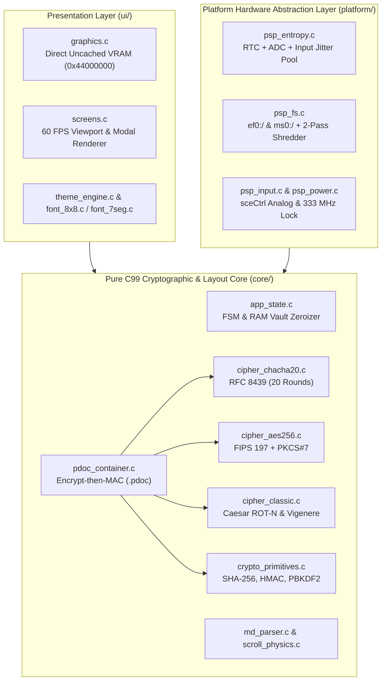

# Technical Architecture & Security Audit Report — `05_CryptoMD_Vault`

> **Detailed engineering specification, memory layout, cryptographic protocol design, and vulnerability audit for the Sony PlayStation Portable Go (PSP-N1000).**

---

## 1. Architectural Philosophy

`05_CryptoMD_Vault` is engineered around a strict **3-Layer Clean Embedded Architecture** written in pure **C99**:



* **`core/` (Zero SDK Dependencies):** Compiles unchanged on both the MIPS Allegrex target (`psp-gcc`) and host POSIX machines (`clang` / `gcc`), allowing 100% deterministic unit testing of all cryptographic primitives, parser rules, and state transitions.
* **`platform/` (Hardware Abstraction):** Isolates Sony PSPSDK syscalls (`sceIo*`, `sceCtrl*`, `scePower*`, `sceRtc*`) behind clean C interfaces with host fallbacks.
* **`ui/` (Direct VRAM Framebuffer Engine):** Renders directly to uncached video memory (`0x44000000`) synchronized to the 60 Hz vertical blanking interval (`sceDisplayWaitVblankStart`).

---

## 2. Cryptographic Engine & Protocol Specification

### 2.1. Key Derivation & Subkey Separation (Levels 3 & 4)
When the user enters a physical button sequence of length $L \in \{2, 4, 6\}$, each physical button is mapped to a deterministic 1-byte token (`BTN_CODE_UP = 1` .. `BTN_CODE_TRIANGLE = 9`).

To prevent brute-force attacks against short physical sequences, `pdoc_pack_encrypt()` derives a 512-bit (64-byte) master key block using **PBKDF2-HMAC-SHA256** (RFC 8018) with a 128-bit random salt:

$$\text{DK}_{64} = \text{PBKDF2-HMAC-SHA256}(\text{Password} = \text{Combo}, \text{Salt} = S_{16}, c = \text{kdf\_iters}, \text{dkLen} = 64)$$

The 64-byte output is split into two independent 256-bit keys:
* **Encryption Key ($K_{\text{enc}}$):** Bytes `0..31` (256 bits) fed into AES-256-CBC or ChaCha20-256.
* **Authentication Key ($K_{\text{mac}}$):** Bytes `32..63` (256 bits) fed into HMAC-SHA256.

Immediately after splitting, the 64-byte intermediate buffer `derived_keys` is scrubbed via `crypto_zeroize()`.

### 2.2. Authenticated Encryption Scheme (*Encrypt-then-MAC*)
Every `.pdoc` container authenticates the **entire 64-byte header** alongside the ciphertext payload:

$$\text{Tag}_{32} = \text{HMAC-SHA256}\left(K_{\text{mac}}, \text{Header}_{64} \parallel \text{Ciphertext}_{N}\right)$$

During `pdoc_verify_decrypt()`, the tag is verified **before** decryption using constant-time byte accumulation:

```c
int crypto_constant_time_memcmp(const void *a, const void *b, size_t len) {
    const volatile uint8_t *pa = (const volatile uint8_t *)a;
    const volatile uint8_t *pb = (const volatile uint8_t *)b;
    uint8_t diff = 0;
    for (size_t i = 0; i < len; i++) {
        diff |= (pa[i] ^ pb[i]);
    }
    return (int)diff;
}
```
If even a single bit of the header, salt, IV/nonce, iteration count, or ciphertext is modified, `crypto_constant_time_memcmp()` returns non-zero in constant time $\mathcal{O}(N)$ and aborts before invoking the cipher engine.

---

## 3. Memory Map & Anti-Leakage Engineering

On the Sony PSP Go, the main thread stack defaults to a small footprint if left unconfigured. Placing large document buffers on the stack risks immediate `$ra` (Return Address) corruption.

`05_CryptoMD_Vault` enforces strict static allocation in `.bss` combined with explicit SDK memory attributes:
* **Thread Stack:** `PSP_MAIN_THREAD_STACK_SIZE_KB(512)` (512 KB).
* **Heap Reservation:** `PSP_HEAP_SIZE_KB(20 * 1024)` (20 MB).
* **Static `.bss` Vault (`g_app`):**
  * `plain_buf[131,104 B]`: 128 KB plaintext capacity + 32-byte safety margin for PKCS#7 unpadding and `NUL` termination.
  * `cipher_buf[131,200 B]`: 128 KB container capacity + 64B header + 32B HMAC tag + 32B margin.
  * `doc_plain` & `doc_cipher`: Pre-allocated 4,096-line layout structures (`md_document`).

---

## 4. Security Audit & Vulnerability Remediation Log

| ID | Category | Vulnerability Analyzed | Remediation Implemented |
| :--- | :--- | :--- | :--- |
| **SEC-01** | Integer / Buffer Overflow | Unbounded `hdr.cipher_len` in crafted `.pdoc` headers could wrap 32-bit `size_t` calculation `64 + cipher_len + 32` or overflow `plain_dst`. | Added strict validation in `pdoc_is_valid_header()` enforcing `cipher_len <= PDOC_MAX_DOC_SIZE + 16`, block alignment (`% 16 == 0`) for AES, and `cipher_len == plain_len` for stream/classical ciphers. |
| **SEC-02** | KDF Downgrade / CPU DoS | Crafted Level 3/4 header with `kdf_iters = 0` bypasses key stretching; `kdf_iters = 0xFFFFFFFF` freezes the 333 MHz MIPS CPU. | Enforced `1000 <= hdr.kdf_iters <= 100000` inside `pdoc_is_valid_header()` for all Level 3 and Level 4 containers. |
| **SEC-03** | Out-of-Bounds Write | Reading a maximum-sized `128 KB` plaintext file and writing `plain_buf[rd] = '\0'` wrote 1 byte past `plain_buf[PDOC_MAX_DOC_SIZE]`. | Expanded `plain_buf` by `+32` bytes and `cipher_buf` to `PDOC_MAX_CONTAINER_SIZE`, bounding plaintext reads to `PDOC_MAX_DOC_SIZE`. |
| **SEC-04** | Side-Channel / Padding Oracle | Early-exit branch in PKCS#7 padding loop in `aes256_cbc_decrypt()` and unzeroized AES `state[4][4]` matrix. | Replaced PKCS#7 loop with constant-time bitwise accumulation (`bad_pad \|= ...`) and added `crypto_zeroize(state, sizeof(state))` in AES block routines. |
| **SEC-05** | Stack Key Residue | Temporary `key_data[64]`, `salt[16]`, and `iv_nonce[16]` buffers on the stack in `main.c` and `tools/cryptodoc_cli.c` remained in stack memory after return. | Added explicit `crypto_zeroize()` calls on all stack key, salt, and nonce buffers across all exit paths, plus bounds-clamping on CLI key inputs. |
